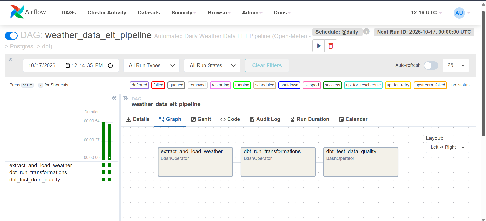
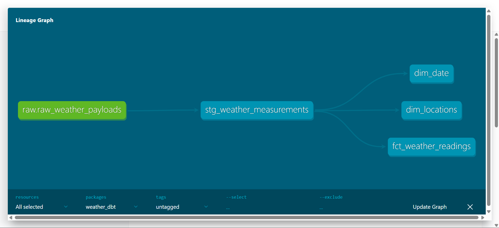

# Automated Weather Data ELT Pipeline

An end-to-end automated Extract, Load, Transform (ELT) data pipeline designed to ingest daily weather metrics from Open-Meteo REST API into PostgreSQL, transform raw payloads into an analytics-ready Star Schema using dbt, and orchestrate the workflow via Apache Airflow in Docker.

---

## Architecture & Workflow

```text
┌────────────────┐      ┌─────────────────────────┐      ┌────────────────────────────────┐
│   Open-Meteo   │ ───> │  Python Ingestion (EL)  │ ───> │      PostgreSQL (Raw)          │
│    REST API    │      │ (Session + Auto-Retry)  │      │  raw.raw_weather_payloads      │
└────────────────┘      └─────────────────────────┘      └────────────────────────────────┘
                                                                         │
                                                                         ▼
┌────────────────────────────────────────────────────────┐       ┌───────────────┐
│              Analytics Star Schema (dbt)               │ <───  │    Staging    │
│  - fct_weather_readings (480 hourly metrics)           │       │  (Unnesting   │
│  - dim_locations (20 Indonesian cities across islands) │       │ & Dedup View) │
│  - dim_date (24-hour calendar & weekend indicator)     │       └───────────────┘
└────────────────────────────────────────────────────────┘
                           ▲
                           │ Orchestrated daily with auto-retries
┌────────────────────────────────────────────────────────┐
│             Apache Airflow (LocalExecutor)             │
│   extract_and_load ──> dbt_run ──> dbt_test            │
└────────────────────────────────────────────────────────┘
```

1. **Extract & Load (EL)**: Python script calls Open-Meteo API for 20 strategic Indonesian cities across 6 major island groups. Payloads are loaded into PostgreSQL under `raw.raw_weather_payloads` in native `JSONB` format with connection pooling and exponential backoff retry.
2. **Transform (T)**: `dbt-core` unnests the 24-hour JSON arrays into 480 structured hourly records in the staging layer (`stg_weather_measurements`), then builds an analytical Star Schema (`fct_weather_readings`, `dim_locations`, `dim_date`).
3. **Data Quality Tests**: 18 automated dbt tests validate primary key uniqueness, not-null constraints, and referential integrity (foreign keys).
4. **Orchestration**: Apache Airflow DAG (`weather_data_elt_pipeline`) schedules daily execution, handles retries, and logs task status.
5. **Containerization**: Docker Compose manages PostgreSQL and Apache Airflow with isolated networking.

---

## Data Modeling Methodology: Kimball Bottom-Up

This project strictly adheres to **Ralph Kimball's Dimensional Modeling (Bottom-Up)** methodology rather than Bill Inmon's Corporate Information Factory (Top-Down 3NF) approach.

### Architectural Justification:
- **Business & Analytics-First**: Kimball modeling prioritizes business analytics agility. By organizing data into a central Fact table (`fct_weather_readings`) connected directly to Dimension tables (`dim_locations`, `dim_date`), analytical queries require straightforward single-level `JOIN` operations instead of complex multi-table relational joins.
- **Controlled Denormalization**: In `dim_locations`, city name, province, and island group are consolidated into a unified location dimension. This eliminates the query overhead of joining normalized sub-tables (`countries -> islands -> provinces -> cities`) while maintaining clear dimensional hierarchy.
- **Surrogate Keys**: Primary keys are implemented using synthetic surrogate keys (`MD5(city_name)` for `location_id`, and `TO_CHAR(reading_time, 'YYYYMMDDHH24')` for `date_id`). This decouples analytics models from upstream operational ID changes and optimizes indexing performance.
- **Native dbt Synergy**: Modern ELT workflows with dbt are built around dimensional DAG transformations, allowing staging models to act as cleaning layers and analytics models to persist as clean Star Schemas.

---

## Tech Stack
- **Language**: Python 3.12, SQL
- **Data Warehouse**: PostgreSQL 15
- **Data Transformation & Modeling**: dbt-core (`dbt-postgres`)
- **Orchestration**: Apache Airflow 2.9 (LocalExecutor)
- **Containerization**: Docker, Docker Compose
- **Data Source**: Open-Meteo REST API

---

## Project Structure

```text
.
├── dags/
│   └── weather_elt_dag.py         # Airflow DAG for daily scheduling
├── dbt_project/
│   ├── dbt_project.yml            # dbt configuration
│   ├── profiles.yml               # PostgreSQL connection profile
│   └── models/
│       ├── staging/
│       │   ├── sources.yml        # Raw source table declaration
│       │   └── stg_weather_measurements.sql # JSON unnesting & cleaning
│       ├── analytics/
│       │   ├── dim_locations.sql  # Location dimension (cities, island groups)
│       │   ├── dim_date.sql       # Time dimension (hours, calendar flags)
│       │   └── fct_weather_readings.sql # Fact table with hourly metrics
│       └── schema.yml             # Data quality tests (unique, not_null, relationships)
├── docs/
│   └── images/                    # Visual screenshots (Airflow UI, dbt Lineage)
├── docker/
│   ├── Dockerfile                 # Custom Airflow image with dbt-postgres
│   └── init-db.sql                # Multi-database initializer (airflow_db, weather_dwh)
├── scripts/
│   ├── __init__.py
│   ├── config.py                  # Database configs & 20 city coordinates
│   ├── extract.py                 # Open-Meteo API client with retry mechanism
│   ├── db.py                      # PostgreSQL raw DDL and batch loader
│   └── run_pipeline.py            # Local EL pipeline entrypoint
├── .env.example                   # Environment configuration template
├── docker-compose.yaml            # Multi-container orchestration
├── requirements.txt               # Local Python dependencies
└── README.md                      # Project documentation
```

---

## Analytical Queries & Business Insights

With the dimensional Star Schema materialized in PostgreSQL, business questions can be queried directly:

### 1. Regional Weather Variance by Island Group
This query aggregates hourly readings to evaluate average temperature, humidity, and wind conditions across major Indonesian island groups:

```sql
SELECT
    l.island_group,
    COUNT(DISTINCT l.city_name) AS total_cities,
    ROUND(AVG(f.temperature_c), 2) AS avg_temp_c,
    ROUND(MAX(f.temperature_c), 2) AS max_temp_c,
    ROUND(AVG(f.relative_humidity_pct), 2) AS avg_humidity_pct,
    ROUND(AVG(f.wind_speed_kmh), 2) AS avg_wind_speed_kmh
FROM public_analytics.fct_weather_readings f
JOIN public_analytics.dim_locations l ON f.location_id = l.location_id
GROUP BY l.island_group
ORDER BY avg_temp_c DESC;
```

**Actual Query Result**:
| island_group | total_cities | avg_temp_c | max_temp_c | avg_humidity_pct | avg_wind_speed_kmh |
|:---|:---:|:---:|:---:|:---:|:---:|
| Sulawesi | 2 | 29.16 | 33.70 | 61.63 | 7.54 |
| Jawa | 6 | 29.05 | 36.70 | 59.16 | 7.76 |
| Kalimantan | 3 | 27.76 | 36.90 | 79.67 | 8.06 |
| Bali-Nusa Tenggara | 3 | 27.71 | 34.60 | 70.63 | 11.08 |
| Sumatera | 4 | 27.34 | 34.60 | 82.55 | 5.79 |
| Maluku-Papua | 2 | 26.79 | 30.30 | 85.25 | 6.50 |

### 2. Top 5 Cities with Highest Peak Temperatures
This query identifies metropolitan areas experiencing extreme heat and evaluates corresponding humidity and wind metrics:

```sql
SELECT
    l.city_name,
    l.province,
    l.island_group,
    MAX(f.temperature_c) AS max_temp_c,
    ROUND(AVG(f.relative_humidity_pct), 1) AS avg_humidity_pct,
    MAX(f.wind_speed_kmh) AS max_wind_speed_kmh
FROM public_analytics.fct_weather_readings f
JOIN public_analytics.dim_locations l ON f.location_id = l.location_id
GROUP BY l.city_name, l.province, l.island_group
ORDER BY max_temp_c DESC
LIMIT 5;
```

**Actual Query Result**:
| city_name | province | island_group | max_temp_c | avg_humidity_pct | max_wind_speed_kmh |
|:---|:---|:---|:---:|:---:|:---:|
| Banjarmasin | Kalimantan Selatan | Kalimantan | 36.9 | 61.1 | 17.70 |
| Semarang | Jawa Tengah | Jawa | 36.7 | 58.4 | 16.90 |
| Jakarta | DKI Jakarta | Jawa | 36.4 | 57.8 | 15.30 |
| Bogor | Jawa Barat | Jawa | 35.6 | 62.8 | 14.50 |
| Yogyakarta | DI Yogyakarta | Jawa | 35.0 | 67.7 | 16.10 |

---

## Pipeline Observability & Visuals

### Apache Airflow Workflow Execution
Automated daily execution with task dependencies and automatic retry policies:
*(Place your screenshot at `docs/images/airflow_dag_success.png`)*



### dbt Interactive Lineage Graph
End-to-end data lineage from raw JSON ingestion to dimensional models:
*(Place your screenshot at `docs/images/dbt_lineage_graph.png`)*



---

## Getting Started

### 1. Prerequisites
- Docker & Docker Compose
- Python 3.10+ (for optional local runs)

### 2. Environment Setup
```powershell
# Copy environment variables
Copy-Item .env.example .env

# Create and activate virtual environment
python -m venv venv
.\venv\Scripts\Activate.ps1
pip install -r requirements.txt
```

### 3. Spin Up Docker Infrastructure
```powershell
# Start PostgreSQL & Airflow (Webserver, Scheduler, Metastore)
docker compose up -d --build
```

### 4. Access Airflow Dashboard
Open your browser and navigate to:
- **URL**: http://localhost:8080
- **Username**: admin
- **Password**: admin

Enable and trigger the DAG `weather_data_elt_pipeline` to run the complete automated pipeline.

### 5. Generate and View dbt Documentation & Lineage Graph
```powershell
.\venv\Scripts\dbt.exe docs generate --project-dir dbt_project --profiles-dir dbt_project
.\venv\Scripts\dbt.exe docs serve --project-dir dbt_project --profiles-dir dbt_project --port 8081
```
Open http://localhost:8081 and click the **Lineage Graph** icon on the bottom right.

---

## Resume Highlights
- Designed and implemented an automated ELT pipeline extracting hourly weather metrics for 20 cities from Open-Meteo REST API into PostgreSQL using Python with connection pooling and exponential backoff retry.
- Built a dimensional Star Schema following Kimball methodology (fact and dimension tables with surrogate keys) and implemented 18 automated dbt tests enforcing uniqueness, non-null constraints, and referential integrity.
- Orchestrated daily end-to-end task dependencies and failure retries via Apache Airflow DAGs.
- Containerized the entire infrastructure using Docker Compose with dual-database architecture for Airflow metastore and analytical data warehouse.
